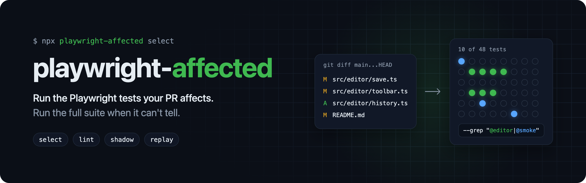

# playwright-affected

Change-based test selection for Playwright. Maps a PR's git diff to tags and test paths, emits one `--grep`, and falls back to the full suite whenever it cannot decide.

- One `--grep` per PR. Selected counts use Playwright's own grep matching, with the limits under [Caveats](#caveats).
- Fails open. A global trigger, an unmapped source file, an empty diff, an empty selection, a map entry that matches no test, or any tool error runs the full suite.
- Measures before you trust it. `replay` scores a map against merged PRs. `shadow` counts the failures a selection would have missed.
- Works in any CI. It needs Node 22.5+ and git. `replay` also needs an authenticated `gh` CLI.

## Config

See [`examples/e2e-map.yml`](examples/e2e-map.yml). Each changed file is checked against these steps in order, and the first step that matches decides:

1. `full_run_triggers`: run the full suite.
2. A `*.test.*` or `*.spec.*` file under `test_dir`: select that file. If the PR deletes it, or renames it away, skip it.
3. `ignore_paths`: skip the file.
4. `mappings`: add the `tags` and `tests` of every mapping that matches.
5. Anything else is unmapped. `unmapped_behavior: full` runs the full suite.

- `test_dir` is the directory Playwright reports test files relative to, written relative to the repo root. That is the top-level `testDir` in `playwright.config`, or the config file's directory if `testDir` is only set per project. `.` is the repo root.
- A tag matches tests that have exactly that tag, ignoring case. `@auth` does not match `@authoring`.
- `tests` entries are plain path prefixes relative to `test_dir`, such as `editor/`. They are not globs.
- Globs use Node's `path.matchesGlob`, except that `*` and `**` also match names that start with a dot: `docs/**` matches `docs/.vitepress/config.ts`. Matching is case-sensitive.
- Globs are relative to the repo root. A glob that starts with `./` or `/` is rejected, because it would never match.

## Commands

```sh
PLAYWRIGHT_JSON_OUTPUT_NAME=list.json npx playwright test --list --reporter=json

npx playwright-affected select --config e2e-map.yml --base origin/main --list list.json --out result.json
npx playwright-affected lint   --config e2e-map.yml --list list.json
npx playwright-affected shadow --result result.json --report full-run.json --pr 123
npx playwright-affected replay --config e2e-map.yml --repo owner/name --base main --limit 200 --list list.json
```

| Command | Output | Exit code |
|---|---|---|
| `select` | `result.json` (below) | 0 for any selection, including a tool error. 2 for bad arguments. 1 if `--out` cannot be written. |
| `lint` | `unreachable`: tests no mapping or always-run tag can select. `dead_entries`: tags and `tests` prefixes that match no test. | 1 if either is non-empty |
| `shadow` | One row: selected and total tests, `unrun_tests`, `report_errors`, deterministic failures, missed failures, flaky tests excluded, `unselected_test_time_s` | 0. 1 if the report has no tests. |
| `replay` | Full-run rate by reason, mapping coverage, mean share of tests run, top unmapped dirs, top triggers, per-PR rows | 0 |

- `select` needs the base ref's history: use `fetch-depth: 0` or fetch the base branch.
- Pass `--list` to `select`. Without it, `select` cannot check that each selected entry matches a test, and a grep that matches nothing makes `playwright test` fail with "No tests found".
- Generate `list.json` with the same `--project` and filters as the CI run, so the counts match.
- Write reports with `PLAYWRIGHT_JSON_OUTPUT_NAME`, not `> file`. Anything the config prints to stdout, such as dotenv's log line, corrupts a redirected report.
- A list with errors (a spec that failed to load) or no tests is rejected: `select` runs the full suite, and `lint` and `replay` exit 1.

## result.json

```json
{
  "base_ref": "origin/main",
  "head_sha": "…",
  "changed_files": ["src/editor/a.ts"],
  "mode": "selected",
  "full_reason": null,
  "trigger_paths": [],
  "ignored_paths": [],
  "unmapped_paths": [],
  "tags": ["@editor", "@smoke"],
  "tests": ["editor/"],
  "grep": "(?:^|\\s)(?:@editor|@smoke)(?=\\s|$)|(?:^|\\s)(?:editor/)",
  "dead_entries": [],
  "selected": 38,
  "total": 240
}
```

- `full_reason` is one of `global_trigger`, `unmapped_paths`, `no_changes`, `empty_selection`, `dead_entry` or `tool_error`.
- If `mode` is `full`, `grep` is `null`.
- Without `--list`, `dead_entries`, `selected` and `total` are `null`.
- A `tool_error` result also has an `error` message.
- A deleted spec, including the old path of a renamed one, is listed in `ignored_paths`.

## CI

```sh
rm -f result.json
npx playwright-affected select --config e2e-map.yml --base "origin/$BASE_BRANCH" --list list.json --out result.json
GREP=$(jq -r '.grep // empty' result.json)
npx playwright test ${GREP:+--grep "$GREP"}
```

- Run selection on PRs only. Keep the full suite on the merge queue or default branch, and on a schedule.
- `rm -f` stops a reused workspace from picking up the previous build's `result.json` if `select` fails to start.
- The map is read from the PR branch, so a PR can change its own selection. The full suite on the merge queue is the safety net.

## Shadow mode

Before you make selection blocking, keep running the full suite on PRs. Add Playwright's `json` reporter, and record `shadow` for each PR. The full run and the selection then use the same commit, so a miss belongs to that PR.

- Exclude rows with `unrun_tests` > 0 or any `report_errors`. Tests in an interrupted run, a run stopped by `maxFailures`, or a `--list` report never ran, so they cannot show a miss. A global setup or teardown error also lands in `report_errors`.
- Merge shard reports with `npx playwright merge-reports --reporter json` before running `shadow`.
- `unselected_test_time_s` is the summed duration of unselected tests, including retries. It is not wall-clock time.

## Caveats

- Playwright always runs tests in projects that a selected project depends on (`dependencies`, `teardown`). The JSON report does not record those links, so the tool counts those tests as unselected, and `lint` reports them as unreachable. Tag them with one of your `always_run_tags` so the counts match.
- Path-based selection assumes `/` separators. On Windows, Playwright matches test paths with `\`, so `tests` prefixes do not match.

## License

MIT
